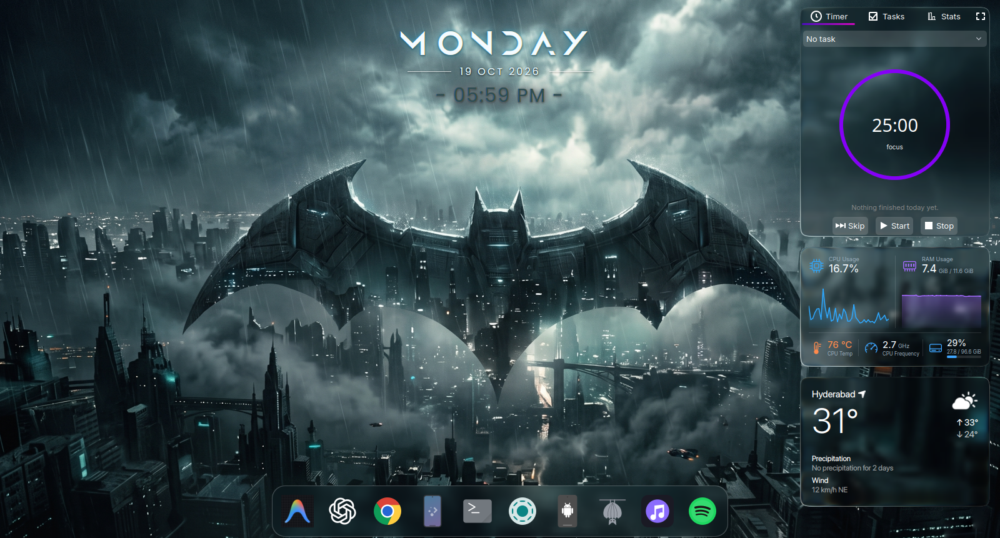
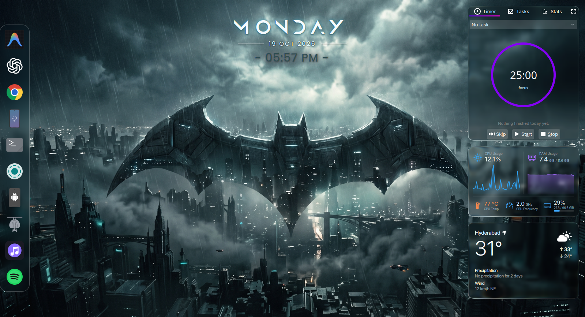

# HUD Dock

A macOS-style dock for KDE Plasma 6 that shows **only the apps you choose**. Running
apps are not added to it.

- **Icon magnification** — icons grow in a smooth wave under the pointer
- **Launch bounce** — the icon bounces when you start an app
- **Frosted-glass shelf** — a blurred copy of your wallpaper behind the icons
- **Pop-up shortcut** — assign a shortcut and the dock appears over any open window
- **Horizontal or vertical**, with adjustable icon size, spacing, zoom and labels
- A settings window with a searchable app picker, reordering and glass controls

## Screenshots

Horizontal, along the bottom edge:



Vertical, on the left edge:



## Requirements

- KDE Plasma 6.0 or newer
- `python3` and `gio` (both ship with a standard Fedora, Arch or Ubuntu KDE install)

Developed and tested on Plasma 6.7 on Fedora 44. Other versions should work but have
not been tested.

## Install

From a release `.plasmoid` file:

```sh
kpackagetool6 --type Plasma/Applet --install com.aadi.huddock.plasmoid
```

From this repository:

```sh
kpackagetool6 --type Plasma/Applet --install "$(pwd)/package"
```

Run this from the repository root. Use an absolute package path so KPackage does
not interpret `package` as an installed plugin name.

To update an existing install:

```sh
kpackagetool6 --type Plasma/Applet --upgrade "$(pwd)/package"
```

Then restart
plasmashell (`kquitapp6 plasmashell; kstart plasmashell`).

Then right-click the desktop, choose **Enter Edit Mode → Add Widgets**, and drag
**HUD Dock** onto the desktop.

## Use

- Drag one or more local `.desktop` application files onto the dock to append them.
  The shelf highlights while dragging; existing entries are not duplicated. This
  also works in the shortcut pop-up and in either orientation. Files are read, not
  copied or launched, so keep them at their original paths. Only add launchers you
  trust: clicking their icons later runs the applications they define.
- Right-click the dock → **Configure** to add, reorder and remove apps and to change
  the look.
- Right-click an icon for **Open**, **Remove from dock** and **Dock settings**.
- **Pop-up shortcut:** in edit mode, right-click the dock → *Configure → Keyboard
  Shortcuts*, and assign a key to *Activate HUD Dock Widget*. Pressing it shows a copy
  of the dock above the windows. It hides itself a few seconds after you stop using it.

## Settings

| Tab | Option | What it does |
| --- | --- | --- |
| Apps | Add / reorder / remove | The apps shown, in order |
| Appearance | Orientation | Horizontal or vertical |
| Appearance | Icon size, spacing | Size of icons and the gap between them |
| Appearance | Magnification | How much the icon under the pointer grows (1.0 = off) |
| Appearance | Launch bounces | Number of bounces on launch (0 = off) |
| Appearance | Labels | Show the app name above the hovered icon |
| Appearance | Glass: tint, blur, sheen | Darkness of the glass, blur strength, top highlight |

## How the glass works

Plasma does not blur the wallpaper behind desktop widgets. The dock takes a snapshot of
the wallpaper layer, blurs it, and clips it to the shelf. The snapshot is refreshed at
start-up and every few seconds, so a changed wallpaper is picked up. Where there is no
wallpaper to sample (for example, in a panel), it falls back to a plain translucent card.

## Known limitations

- The dock is a **desktop widget**, not a screen-edge dock. Windows can cover it and it
  does not reserve screen space.
- The pop-up copy is a notification-type window, so it cannot take keyboard focus (Esc
  will not close it) and shows a darker, un-blurred shelf because it sits above other
  windows.
- The bounce runs a fixed number of times; it does not wait for the app to open.
- There are no running-app indicators by design.

## Packaging

```sh
./make-package.sh        # creates dist/com.aadi.huddock.plasmoid
```

Each successful build increments the numeric SemVer build metadata in
`KPlugin.Version` in [package/metadata.json](package/metadata.json), for example
`1.1.0` -> `1.1.0+1` -> `1.1.0+2`. The saved version and the version inside the
package match. Major, minor, patch and any prerelease suffix are preserved; setting
a new release version without `+BUILD` restarts its build counter at 1.
The build requires Python 3 and uses its standard-library ZIP support.

## Tests

Run the importer and packaging tests with Python 3. If PyQt6 is installed, this also tests native
file drag-and-drop events against the QML drop area:

```sh
QT_QPA_PLATFORM=offscreen QT_QUICK_BACKEND=software python3 -m unittest discover -s tests -v
```

Run the shared QML helper tests with the Qt 6 `qmltestrunner` (its location depends
on the distribution):

```sh
QT_QPA_PLATFORM=offscreen QT_QUICK_BACKEND=software /usr/lib/qt6/bin/qmltestrunner -input tests
```

## Support

HUD Dock is free and always will be. If you enjoy it, you can support its development:

- On the KDE Store page, use the **Donate** button.
<!-- Add your own links below, then delete this comment:
- GitHub Sponsors: https://github.com/sponsors/<your-username>
- Ko-fi: https://ko-fi.com/<your-name>
- Liberapay: https://liberapay.com/<your-name>
-->

Bug reports and ideas are welcome too.

## License

GPL-3.0-or-later. See [LICENSE](LICENSE).
